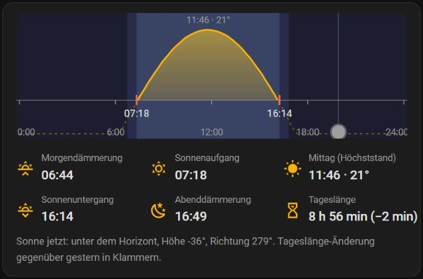

# Sonnen-Karte

Sonnenbogen mit Dämmerung, Auf- und Untergang, Mittag und Tageslänge



## Installation

### Über den Marketplace (Home Assistant 2026.11 und neuer)

1. **Einstellungen** → **Marketplace** → **Aus Link hinzufügen**.
2. Die Adresse dieses Repositorys eintragen, Kategorie **Dashboard**.
3. **Sonnen-Karte** installieren. Die Ressource wird dabei automatisch eingetragen.

### Über HACS (ältere Versionen)

**HACS** → ⋮ → **Benutzerdefinierte Repositories** → Adresse dieses Repositorys, Typ **Dashboard** → installieren.

### Manuell

`sonnen-karte.js` nach `/config/www/` kopieren und unter **Einstellungen** → **Dashboards** → ⋮ → **Ressourcen**
als JavaScript-Modul `/local/sonnen-karte.js` eintragen.

## Verwendung

```yaml
type: custom:sonnen-karte
```

## Konfiguration

```
Sonnen-Karte: Tagesbogen der Sonne mit Daemmerung, Aufgang, Mittag, Untergang und aktueller Position.
Die Zeiten werden aus dem Standort von Home Assistant berechnet (Formeln wie SunCalc).

  type: custom:sonnen-karte
```

## Lizenz

MIT
